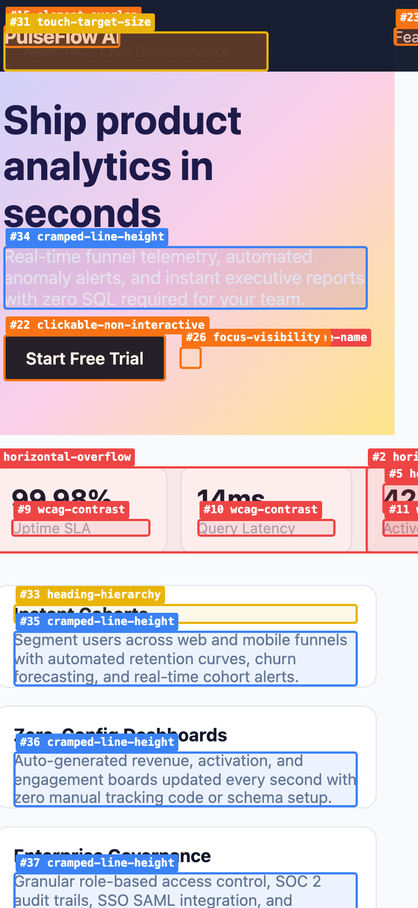
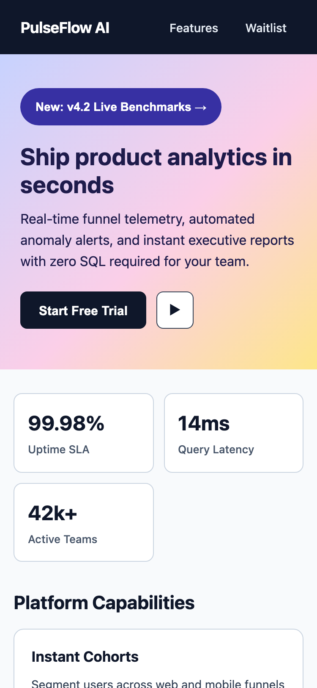

# UI Surgeon

**Closed-Loop Visual Geometry, Pixel-Verified Contrast (WCAG 2.1 + APCA), and WCAG 2.2 Accessibility Surgeon for Claude Code & CI.**

Zero npm dependencies. Powered by Node 22+ native WebSocket CDP + pure-JS PNG pixel decoding.

---

## Why UI Surgeon Exists

Vision models and human reviewers routinely miss subtle UI defects that break production apps:
- **2–40px mobile horizontal overflow** (`scrollWidth > clientWidth`)
- **Contrast failures over CSS gradients, glassmorphism, or hero photos** (even `axe-core` marks gradients as *incomplete*; UI Surgeon decodes the rendered PNG pixels directly!)
- **Sticky headers silently blocking clicks** (`elementFromPoint` hit-test occlusion)
- **Text clipped inside fixed-height `overflow: hidden` cards**
- **Missing `:focus-visible` rings & keyboard focus occlusion** verified via real CDP `Tab` keystrokes
- **Sub-24px WCAG 2.2 / sub-44px mobile touch targets**, clickable `<div>`s, unlabeled inputs, and broken/distorted images

Instead of guessing from a downscaled screenshot, **UI Surgeon** gives Claude Code deterministic numbers, exact CSS selectors, hue-preserving accessible hex color fixes, annotated bounding-box screenshots, and baseline regression diffing — looping until **0 critical / 0 high defects** remain.

---

## Before vs After (Real Mobile 375px Closed-Loop Surgery)

| Without UI Surgeon (**0/100 · 110 defects**) | With UI Surgeon (**100/100 · 0 defects · 0 regressions**) |
| :---: | :---: |
|  |  |

Run the interactive side-by-side studio locally:
```bash
node demo/serve.mjs
# Open http://127.0.0.1:4173
```

---

## Quick Start

### 1. Install as a Claude Code Plugin
```bash
/plugin marketplace add danielmatzenj-png/ui-surgeon
/plugin install ui-surgeon@ui-surgeon-marketplace
```

### 2. Or Install as a Standalone Agent Skill (Claude Code / Cursor / Codex / Antigravity)
```bash
npx ui-surgeon --install-skill
# Or per-project:
npx ui-surgeon --install-skill --project
```

### 3. Run Directly from the CLI or CI (Zero Dependencies!)
```bash
# Audit a live dev server across mobile (375px), tablet (768px), and desktop (1440px)
npx ui-surgeon http://localhost:3000

# Audit a local HTML file or static build folder (dist/, out/, public/) with dark mode + annotated screenshots
npx ui-surgeon ./dist --dark-mode --annotate --out .ui-surgeon/pass-0

# Closed-loop regression gate against previous pass
npx ui-surgeon http://localhost:3000 --baseline .ui-surgeon/pass-0/report.json --fail-on high

# Emit GitHub Code Scanning SARIF 2.1.0
npx ui-surgeon ./dist --format sarif > ui-surgeon.sarif
```

---

## Built-In Deterministic Rules (20 Checks Across 5 Categories)

| Category | Rules | Standard |
| --- | --- | --- |
| **Geometry** | `horizontal-overflow`, `hit-test-occlusion`, `element-overlap`, `text-clipping`, `touch-target-size` | WCAG 2.2 SC 1.4.10, 2.4.11, 2.5.8 |
| **Contrast** | `wcag-contrast` (ancestor alpha-compositing + **PNG pixel sampling** + **APCA Lc** + hue-preserving hex solver) | WCAG 2.1 SC 1.4.3, WCAG 3.0 APCA |
| **Accessibility** | `missing-accessible-name`, `missing-form-label`, `missing-alt-text`, `heading-hierarchy`, `missing-landmarks`, `duplicate-id`, `clickable-non-interactive`, `focus-visibility` (live CDP `Tab` dispatch) | WCAG 2.1/2.2 Levels A & AA |
| **Media & Typography** | `broken-image`, `distorted-image`, `unreadable-font-size`, `cramped-line-height`, `unloaded-webfont` | WCAG 1.1.1, 1.4.4, 1.4.12 |
| **Runtime** | `console-error`, `failed-network-asset`, `layout-shift` (real CLS observer) | Core Web Vitals & Runtime |

---

## Closed-Loop Workflow Inside Claude Code

Invoke `/ui-surgeon http://localhost:3000` in Claude Code. The skill enforces a strict verification loop:

1. **Measure** across `mobile`, `tablet`, and `desktop` (+ optional `--dark-mode`).
2. **Diagnose root causes** (never band-aid `overflow-x: hidden` on `body`).
3. **Apply minimal surgical edits** using exact selectors and hue-preserving `suggestedHex` values.
4. **Re-measure with `--baseline`** to guarantee **0 regressions introduced**.
5. **Converge** to **0 critical / 0 high defects** and report score progression (`e.g. 12/100 -> 100/100`).

---

## Extensible Community Rules (`--rules-dir`)

Write a custom rule in ~20 lines of zero-dependency JavaScript (see [`examples/custom-rules/no-placeholder-copy.mjs`](examples/custom-rules/no-placeholder-copy.mjs)) and load it with:

```bash
npx ui-surgeon http://localhost:3000 --rules-dir ./examples/custom-rules
```

We welcome community rule PRs (Tailwind tokens, SEO/OG tags, RTL layout checks, design system linters). See [`CONTRIBUTING.md`](CONTRIBUTING.md).

---

## Requirements

- **Node.js >= 22** (uses built-in `WebSocket`, `fetch`, and `node:zlib`)
- Any installed Chromium browser (**Google Chrome**, **Chromium**, **Edge**, **Brave**, **Arc**, or Playwright's cached Chromium). Override via `UI_SURGEON_CHROME=/path/to/chrome`.

## License

MIT
